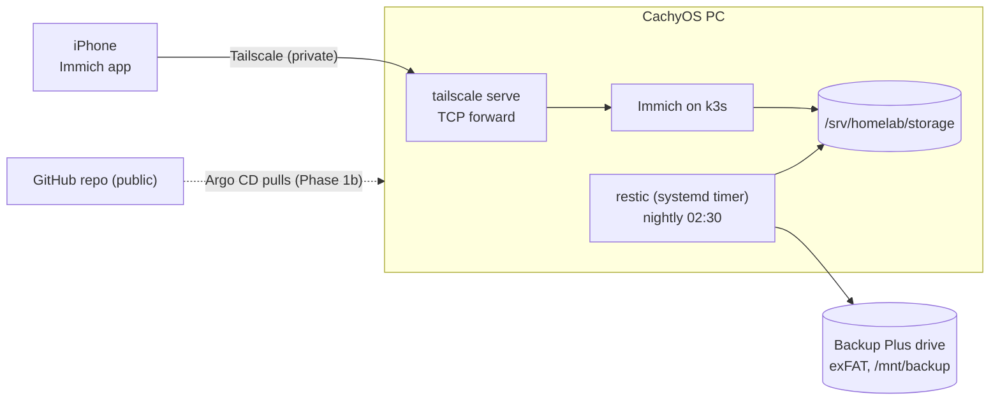

# HomeLab

Self-hosted photo backup and personal cloud, run as code. Started with **iPhone photos → Immich → nightly encrypted backup to an external drive**, built so the whole setup moves to another PC with `git clone` + a key + the drive.

> [!NOTE]
> **Status: Phase 0 applied; Phase 1a built (Immich on k3s, reachable on the tailnet, nightly restic backup to the external drive).** First manual backup and a mechanical restore drill passed. **Verified with 8 real photos:** backup run (37 MiB snapshot), restore into a scratch dir (checksums identical to live) and DB restore into a scratch database (8 assets), unplugged-drive test (job fails, SSD unchanged). **Still unverified:** reboot test, the timer's first scheduled run. Not yet done: age key copy in a cloud password manager, GitHub repo, first commit. Anything marked *Planned* in the docs is design, not tested behaviour.

## Architecture



| Layer | Choice | Why |
|---|---|---|
| Cluster | k3s, single node | GitOps with Argo CD; lighter than full Kubernetes |
| Photos | Immich | Google Photos-like, official iOS app |
| Backup | restic → external drive | Encrypted, deduplicated, plain files readable on any OS |
| Access | Tailscale | Private, no router ports, no VPS |
| Secrets | SOPS + age | Encrypted secrets can live in a public repo |

Full reasoning: [docs/decisions.md](docs/decisions.md).

## Repository map

| Path | What it holds | README |
|---|---|---|
| [`bootstrap/`](bootstrap/) | Phase 0 scripts: prechecks, storage, drive mount, age key, k3s | [bootstrap/README.md](bootstrap/README.md) |
| [`apps/`](apps/) | One folder per app (Immich first) | [apps/README.md](apps/README.md) |
| [`platform/`](platform/) | Backup job, monitoring | [platform/README.md](platform/README.md) |
| [`argocd/`](argocd/) | Argo CD root app (GitOps) | [argocd/README.md](argocd/README.md) |
| [`secrets/`](secrets/) | SOPS-encrypted secrets only | [secrets/README.md](secrets/README.md) |
| [`.githooks/`](.githooks/) | Pre-commit guard for the public repo | below |
| [`docs/`](docs/) | The guide: start at [docs/README.md](docs/README.md) | |

## Quick start (Phase 0)

Every script is a **dry run** unless you set `APPLY=1`.

```bash
sudo pacman -S age sops gitleaks restic tailscale shellcheck   # tools
./bootstrap/scripts/01-preflight.sh                            # read-only checks
./bootstrap/scripts/02-free-ram.sh                             # preview; APPLY=1 to stop kind/Jenkins
```

Then 03 → 04 → 05, each previewed first. Full walkthrough with checks and rollback: [docs/getting-started.md](docs/getting-started.md).

## Safety rules for this public repo

- Only SOPS-encrypted files may live in `secrets/`. The private age key never enters git.
- `.githooks/pre-commit` blocks unencrypted secrets, runs `gitleaks`, and syntax-checks shell scripts. It is enabled with `git config core.hooksPath .githooks`.
- Keep out of the repo: domain names, public IPs, tailnet and device names, photos.

## Roadmap

[docs/roadmap.md](docs/roadmap.md): Phase 1a photos + backup + restore drill → 1b Argo CD + monitoring → 2 Jellyfin, Nextcloud, Vaultwarden, dashboard, offsite copy.
