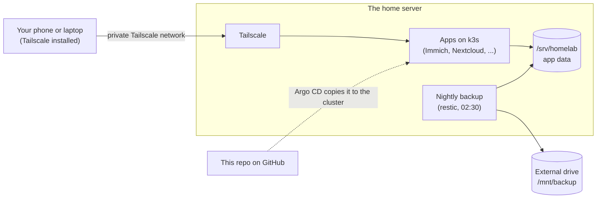

# HomeLab

A small home server you can rebuild from this repository. It runs your own photo library, file sync, password manager, media server and torrent client. Only your own devices can reach it. Every night it backs up to an external drive.

Everything is written as code. To move to another computer you need three things: this repo, one secret key, and the backup drive.

## What it runs

| App | What it is for |
|---|---|
| **Immich** | Photo and video library (like Google Photos) |
| **Nextcloud** | File sync and sharing |
| **Vaultwarden** | Password manager (works with Bitwarden apps) |
| **Jellyfin** | Movies and shows |
| **qBittorrent** | Torrent downloads |
| **Homepage** | One start page with links to every app |
| **Grafana and Prometheus** | Graphs and alerts about the server |

## How it fits together



| Tool | What it does | Why we chose it |
|---|---|---|
| **k3s** | Runs the apps (a small version of Kubernetes) | Light, and works with Argo CD |
| **Argo CD** | Makes the cluster match this repo | Change the repo, the server follows |
| **Tailscale** | Private network between your devices and the server | No open router ports |
| **restic** | Encrypted nightly backup | One program, plain files, works on any system |
| **SOPS + age** | Encrypts secrets so they can live in a public repo | Passwords stay private, config stays in git |

The reasons in detail: [docs/decisions.md](docs/decisions.md).

## What is in this repo

| Folder | What it holds | Guide |
|---|---|---|
| [`bootstrap/`](bootstrap/) | Scripts that prepare the computer: storage, backup drive, secret key, k3s | [bootstrap/README.md](bootstrap/README.md) |
| [`apps/`](apps/) | One folder per app | [apps/README.md](apps/README.md) |
| [`platform/`](platform/) | The nightly backup and the monitoring | [platform/README.md](platform/README.md) |
| [`argocd/`](argocd/) | Argo CD setup (the GitOps part) | [argocd/README.md](argocd/README.md) |
| [`secrets/`](secrets/) | Encrypted secrets, and nothing else | [secrets/README.md](secrets/README.md) |
| [`.githooks/`](.githooks/) | A check that runs before every commit and blocks secrets | [docs/secrets.md](docs/secrets.md#the-pre-commit-check) |
| [`docs/`](docs/) | The full guide. Start with [docs/README.md](docs/README.md) | |

## Quick start

Install these programs first: `age`, `sops`, `gitleaks`, `restic`, `tailscale`, `helm`, `kubectl`, `docker`, `shellcheck`.

Every script only **previews** what it would do. Add `APPLY=1` to do it for real.

```bash
./bootstrap/scripts/01-preflight.sh           # check the computer (changes nothing)
./bootstrap/scripts/03-storage.sh             # preview
APPLY=1 ./bootstrap/scripts/03-storage.sh     # do it
```

Then scripts 04 and 05 the same way. The full walkthrough, with a check and an undo for every step: [docs/getting-started.md](docs/getting-started.md).

## Rules for this public repo

- Only SOPS-encrypted files may be in `secrets/`. The private age key never goes into git.
- The pre-commit check blocks plain-text secrets and runs `gitleaks`. Turn it on once with `git config core.hooksPath .githooks`.
- Keep these out of the repo: domain names, public IP addresses, Tailscale network and device names, and your own photos.

## Roadmap

What is built and what comes next: [docs/roadmap.md](docs/roadmap.md).
