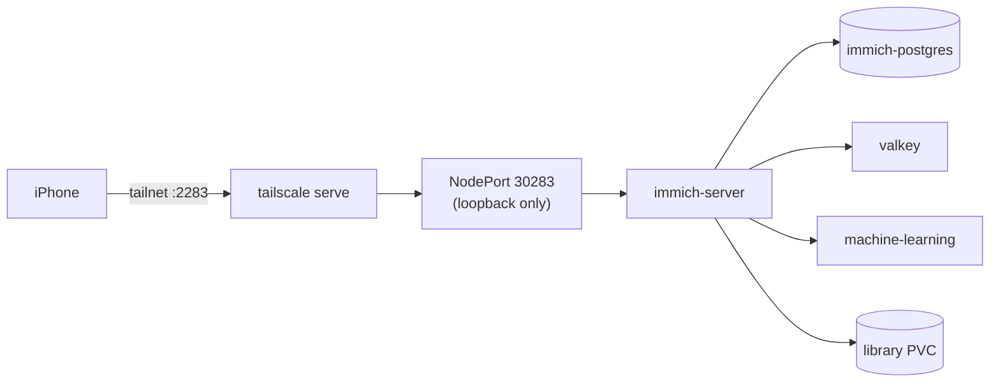

# apps/immich

Immich (self-hosted Google Photos alternative) on k3s. **Built and running (Phase 1a).** Installed by hand with Helm; Argo CD takes over in Phase 1b.

## Files

| File | What it does |
|---|---|
| `namespace.yaml` | Creates the `immich` namespace. |
| `pvc.yaml` | 150 Gi library volume. k3s `local-path` stores it under `/srv/homelab/storage`; the size is documentation only, local-path does not enforce it. |
| `postgres.yaml` | Single-pod Postgres (StatefulSet) with the vectorchord extension. Same image Immich's own docker-compose uses, pinned by digest. Credentials come from the Secret `immich-db`. |
| `values.yaml` | Overrides for the official Helm chart: Immich version, library PVC, valkey on, DB env from the Secret, memory limits. |
| `nodeport.yaml` | Service on loopback port 30283, the entry point for `tailscale serve`. |
| `install.sh` | Creates the encrypted DB secret once, applies everything, runs `helm upgrade --install`. |

## Architecture



## Code blocks worth knowing

- **Why our own Postgres:** the chart ships no database and requires vectorchord. A one-pod StatefulSet is less to run than the CloudNativePG operator for a single home server.
- **`install.sh` secret flow:** `sops -e --filename-override ... /dev/stdin` encrypts the generated password without writing plaintext to disk. `sops -d | kubectl apply -f -` decrypts it in memory straight into the cluster.
- **Memory limits (`values.yaml`):** server and ML are capped at 2 Gi each so a runaway job cannot push this 15 GB machine into heavy swap.
- **Chart vs Immich version:** the chart (0.13.4) and the Immich image (`v3.2.0`) are pinned separately. Bump `CHART_VERSION` in `install.sh` and the tag in `values.yaml` on purpose.

## Operate

```bash
APPLY=1 ./apps/immich/install.sh                 # install or upgrade
kubectl -n immich get pods                       # status (KUBECONFIG=~/.kube/homelab)
helm -n immich uninstall immich                  # remove app; PVCs and data stay
```

Open `http://<tailscale-ip>:2283` from a device on your tailnet (the PC's Tailscale IP) and create the admin account.
