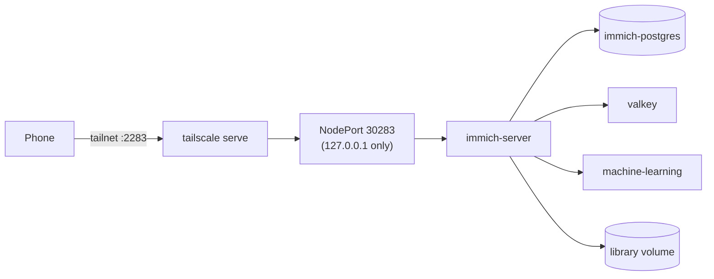

# apps/immich/

Immich is a photo and video library with phone upload and face search. It is an open source alternative to Google Photos.

## Files

| File | What it does |
|---|---|
| `namespace.yaml` | Creates the `immich` namespace |
| `pvc.yaml` | The photo library volume (150 Gi). k3s keeps it under `/srv/homelab/storage`. The size is a note only: `local-path` does not enforce it. |
| `postgres.yaml` | The database: a one-pod Postgres (StatefulSet) with the vectorchord extension, pinned by digest. The login comes from the secret `immich-db`. |
| `values.yaml` | Settings for the official Helm chart: Immich version, library volume, valkey on, database login, memory limits |
| `nodeport.yaml` | A private port (30283 on `127.0.0.1`), the entry point for `tailscale serve` |
| `install.sh` | Creates the encrypted database secret once, applies everything, runs `helm upgrade --install` |

## How it fits together



## Ideas worth knowing

- **Why our own Postgres.** The chart has no database, and Immich needs the vectorchord extension. One StatefulSet is simpler than an operator for one home server.
- **The secret flow in `install.sh`.** `sops -e ... /dev/stdin` encrypts the new password without writing plain text to disk. `sops -d | kubectl apply -f -` decrypts it in memory, straight into the cluster.
- **Memory limits.** The server may use up to 4 Gi, machine learning 2 Gi, Postgres 1 Gi. A runaway job cannot push the whole machine into heavy swap.
- **Two versions.** The chart version is in `install.sh`. The Immich version is in `values.yaml`. They are separate. Change them on purpose, or merge the Renovate pull request.

## Use it

```bash
APPLY=1 ./apps/immich/install.sh        # install or upgrade
kubectl -n immich get pods              # status
helm -n immich uninstall immich         # remove the app. The volumes and data stay.
```

Publish it: `sudo tailscale serve --bg --tcp 2283 tcp://127.0.0.1:30283`. Then open `http://<tailscale-ip>:2283` from a device on your tailnet and create the admin account.
