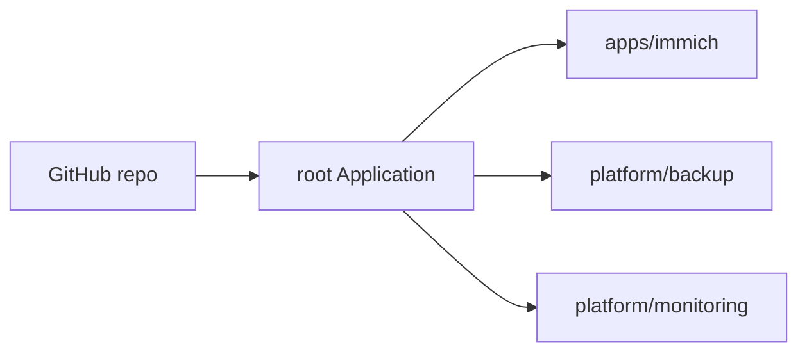

# argocd/

GitOps entry point. **Empty until Phase 1b.**

Argo CD watches this repository and makes the cluster match it. The plan is an *app-of-apps*: one root `Application` here that points at one `Application` per folder in [`../apps/`](../apps/) and [`../platform/`](../platform/).

Argo CD needs the KSOPS plugin and the age private key (created by hand once) to decrypt [`../secrets/`](../secrets/). See [../docs/secrets.md](../docs/secrets.md).

Phase 1a installs apps by hand with Helm first, to prove backup and restore work before adding Argo CD.
