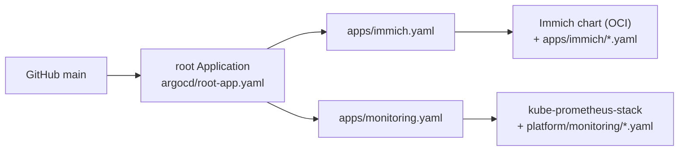

# argocd/

GitOps entry point (Phase 1b). Applied after the photo upload finished.

Argo CD watches this repository on GitHub and makes the cluster match it. One root `Application` creates one `Application` per file in `apps/`.

## Files

| File | What it does |
|---|---|
| `install.sh` | Installs Argo CD core, creates the Grafana secret (SOPS), applies `repos.yaml` and the root app. Dry run unless `APPLY=1`. Refuses if git has unpushed changes. |
| `repos.yaml` | Registers the GHCR OCI registry so Argo can pull the Immich chart. |
| `project-default.yaml` | The `default` AppProject. Core install lacks the API server that creates it. |
| `root-app.yaml` | App-of-apps root, pointed at `argocd/apps/`. |
| `apps/immich.yaml` | Immich: official chart + `apps/immich/values.yaml` + `pvc`, `postgres`, `nodeport` manifests. `prune: false` so a bad commit cannot delete the photo volume. |
| `apps/monitoring.yaml` | Prometheus + Grafana chart + `platform/monitoring/` values, alert rules, Grafana entry point. |

## Decisions and limits

- **Argo CD "core" install:** no web UI, no dex, no API server. It saves RAM on a 15 GB machine. Use `argocd admin dashboard` for a UI when needed.
- **Secrets are not synced by Argo yet.** `immich-db` and `grafana-admin` are created by the install scripts from the SOPS files. Full GitOps for secrets needs the KSOPS plugin and is deferred.
- **Taking over a running Immich:** Argo renders the chart itself and adopts the existing resources. The old Helm release record stays but is unused. Do this when no upload is running, and watch the pods during the first sync.
- **Untested:** none of these files has been applied. The OCI chart source, multi-source `$values` references and the node-exporter textfile mount are the likeliest places to need fixes.

## Rollback

`kubectl delete application root -n argocd` stops management (resources stay). `kubectl delete -n argocd -f core-install.yaml` removes Argo CD itself.
