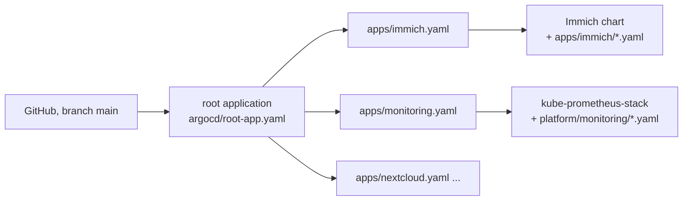

# argocd/

The GitOps part. Argo CD watches this repo on GitHub and makes the cluster match it.

One **root application** creates one Argo CD application for every file in `argocd/apps/`.

To add an app: add a file to `argocd/apps/` and merge it to `main`.

## Files

| File | What it does |
|---|---|
| `install.sh` | Installs Argo CD core, creates the Grafana password (encrypted), applies `repos.yaml` and the root app. A preview unless `APPLY=1`. It refuses to run if you have unpushed changes. |
| `repos.yaml` | Lets Argo CD pull the Immich chart from the GHCR registry |
| `project-default.yaml` | The `default` project. The core install has no API server, which normally creates it. |
| `root-app.yaml` | The root application, pointed at `argocd/apps/` |
| `apps/*.yaml` | One application for each of: Immich, monitoring, Nextcloud, Vaultwarden, Jellyfin, qBittorrent, Homepage |

Apps that hold data use `prune: false`. A mistaken commit then cannot delete a photo library or a database volume.

## Decisions and limits

- **The "core" install** has no web page, no login server and no API server. It uses less memory. For a web page, run `argocd admin dashboard -n argocd`.
- **Argo CD does not manage the secrets.** The `install.sh` scripts create them from the SOPS files. Managing them from Argo CD would need the KSOPS plugin, which is not set up.
- **Immich:** Argo CD renders the chart itself and adopts the pods that `apps/immich/install.sh` created. The old Helm release record stays, unused. Do this when no upload is running, and watch the pods during the first sync.

## Undo

- `kubectl delete application root -n argocd` stops Argo CD managing the apps. The apps keep running.
- To remove Argo CD itself: `kubectl delete -n argocd -f https://raw.githubusercontent.com/argoproj/argo-cd/<version>/manifests/core-install.yaml`
