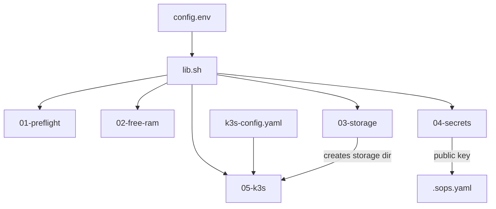

# bootstrap/

Phase 0: turn a fresh CachyOS PC into a k3s host with storage, a backup-drive mount, and an age key. Plain bash, no dependencies beyond the tools listed in the root README.

## Safety model

Every script **previews** by default and changes nothing. Add `APPLY=1` to execute:

```bash
./bootstrap/scripts/03-storage.sh          # prints the commands it would run
APPLY=1 ./bootstrap/scripts/03-storage.sh  # runs them
```

Scripts are idempotent: re-running skips what already exists.

## Files

| File | Role |
|---|---|
| `config.env` | The only machine-specific values: data root, drive label, mount point, container regex, key paths. |
| `k3s-config.yaml` | k3s server config template. `05-k3s.sh` fills `@HOMELAB_ROOT@` and installs it. |
| `scripts/lib.sh` | Shared helpers: `log/warn/die`, `need` (require commands), `run` (dry-run aware). |
| `scripts/01-preflight.sh` | Read-only check: tools, RAM, swap, disk, btrfs, drive, containers, port 6443. |
| `scripts/02-free-ram.sh` | Stops kind/Jenkins containers (by `STOP_REGEX`) and records them for restart. |
| `scripts/03-storage.sh` | Creates `/srv/homelab/{k3s,storage}`, protects the mountpoint, adds the drive to fstab. |
| `scripts/04-secrets.sh` | Generates the age key and writes its public half to `.sops.yaml`. |
| `scripts/05-k3s.sh` | Installs k3s and writes `~/.kube/homelab`. |

## How the pieces connect



## Code blocks worth knowing

**`run` (lib.sh)** prints a command and executes it only when `APPLY=1`. All mutating steps use it; this is the whole dry-run mechanism.

**`chattr +C` on `storage/` (03)** disables copy-on-write for new files under it. Good for Postgres; set while the directory is empty because only new files inherit it.

**`chattr +i` on `/mnt/backup` (03)** makes the *empty* mountpoint immutable. With the drive unplugged, a backup job cannot write there and silently fill the SSD. The drive mounts over it normally.

**fstab `x-systemd.automount,nofail` (03)** mounts the drive on first access and never blocks boot if it is unplugged.

**Separate kubeconfig (05)** writes `~/.kube/homelab`, so existing kind contexts in `~/.kube/config` are untouched.

## Rollback

| Script | Undo |
|---|---|
| 02 | `xargs docker start < ~/.cache/homelab/stopped.txt` |
| 03 | `sudo chattr -i /mnt/backup`, remove the fstab line, `sudo rm -r /srv/homelab` (empty only) |
| 04 | Delete `$AGE_KEY_FILE` only if nothing is encrypted with it |
| 05 | `/usr/local/bin/k3s-uninstall.sh` |
