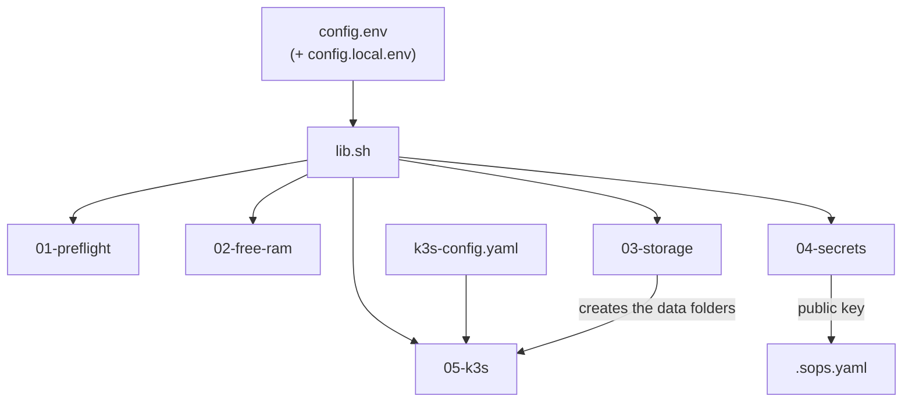

# bootstrap/

Scripts that get a fresh Linux computer ready to run HomeLab: data folders, backup drive, secret key and k3s. They are plain bash. They need only the programs listed in the [main README](../README.md).

## How the scripts stay safe

Every script is a **preview** by default. It prints the commands and changes nothing. Add `APPLY=1` to run them for real:

```bash
./bootstrap/scripts/03-storage.sh           # shows the commands it would run
APPLY=1 ./bootstrap/scripts/03-storage.sh   # runs them
```

You can run any script again. It skips what already exists.

## Files

| File | What it does |
|---|---|
| `config.env` | The settings: data folder, drive label, mount point, key path |
| `config.local.env` | Your own values for this machine (optional, ignored by git) |
| `k3s-config.yaml` | The k3s settings. `05-k3s.sh` fills in the data folder and installs it. |
| `scripts/lib.sh` | Helper functions that every script shares |
| `scripts/01-preflight.sh` | Checks programs, memory, swap, disk, drive and port 6443. Changes nothing. |
| `scripts/02-free-ram.sh` | Stops Docker containers that match `STOP_CONTAINERS_REGEX` (optional) |
| `scripts/03-storage.sh` | Creates the data folders, protects the mount point, adds the drive to `/etc/fstab` |
| `scripts/04-secrets.sh` | Creates the age key and writes its public half into `.sops.yaml` |
| `scripts/05-k3s.sh` | Installs k3s and saves a kubeconfig file |

Run them in number order. Step by step: [docs/getting-started.md](../docs/getting-started.md).

## How the pieces connect



## The functions in `lib.sh`

| Function | What it does |
|---|---|
| `log`, `warn`, `die` | Print a message. `die` also stops the script. |
| `need program...` | Stops the script if a program is not installed |
| `run command...` | Prints a command. Runs it only when `APPLY=1`. **Every command that changes something uses this.** |
| `random_password` | Prints a random password |
| `tailnet_name` | Prints the server's Tailscale name |
| `create_namespace name` | Creates a Kubernetes namespace if it is missing |
| `create_secret_file file function` | Encrypts a new secret into `file`, only if `file` does not exist yet |
| `apply_secret file` | Decrypts a secret in memory and sends it to the cluster |

The app scripts in `apps/` and `platform/backup/` use the same functions, so they behave the same way.

## Ideas worth knowing

- **`chattr +C` on `storage/`** turns off copy-on-write for new files. That is better for databases. Run it while the folder is empty, because only new files get it.
- **`chattr +i` on `/mnt/backup`** makes the empty folder read-only. If the drive is unplugged, a backup cannot write to the main disk. The drive mounts over it normally.
- **`x-systemd.automount,nofail` in `/etc/fstab`** mounts the drive the first time something opens it, and never stops the computer from booting.
- **A separate kubeconfig** (`~/.kube/homelab`) leaves your normal `~/.kube/config` untouched.

## Undo

| Script | How to undo |
|---|---|
| 02 | `xargs docker start < ~/.cache/homelab/stopped-containers.txt` |
| 03 | `sudo chattr -i /mnt/backup`, remove the line from `/etc/fstab`, and `sudo rm -r /srv/homelab` (only while it is empty) |
| 04 | Delete the key file, only if nothing is encrypted with it |
| 05 | `/usr/local/bin/k3s-uninstall.sh` |
