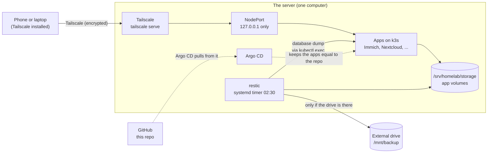

# Architecture

How the pieces fit together, where the data lives, and how it moves.

## The picture



A solid line is data moving. A dotted line is configuration moving. No photos and no plain-text secrets travel on a dotted line.

## The parts

| Part | Job |
|---|---|
| **k3s** | A small Kubernetes on one computer. Runs every app. Traefik and servicelb are switched off to save memory. NodePorts listen on `127.0.0.1` only. |
| **Argo CD** | Watches this repo on GitHub. Makes the cluster match it. |
| **Tailscale** | The only way in. No port is opened on the router. |
| **Immich** | Photo and video library. Helm chart plus its own Postgres and valkey. |
| **Nextcloud** | File sync. Own Postgres. |
| **Vaultwarden** | Password manager. Data in a SQLite file. |
| **Jellyfin** | Media server. Reads `/srv/homelab/media`. |
| **qBittorrent** | Torrent client. Saves to `/srv/homelab/media/downloads`, so Jellyfin sees the files. |
| **Homepage** | Start page with links to every app. |
| **Prometheus and Grafana** | Metrics, graphs and three alerts (see below). |
| **restic** | Nightly encrypted backup to the external drive. |
| **SOPS + age** | Encrypts secrets so they can live in this public repo. |

## How a request reaches an app

1. You open an address such as `http://<tailscale-ip>:2283`.
2. Tailscale carries the request, encrypted, to the server.
3. `tailscale serve` hands it to a **NodePort** on `127.0.0.1`.
4. The NodePort leads to the app's pod.

Step 3 is the key to privacy. The NodePort only listens on `127.0.0.1`, so the home network cannot reach the app. Only Tailscale can.

| App | Tailscale address | NodePort |
|---|---|---|
| Immich | `http://<tailscale-ip>:2283` | 30283 |
| Jellyfin | `http://<tailscale-ip>:8096` | 30096 |
| qBittorrent | `http://<tailscale-ip>:8081` | 30081 |
| Homepage | `http://<tailscale-ip>/` | 30800 |
| Grafana | `http://<tailscale-ip>:3000` | 30300 |
| Prometheus | `http://<tailscale-ip>:9090` | 30900 |
| Nextcloud | `https://<name>.ts.net:8443` | 30443 |
| Vaultwarden | `https://<name>.ts.net:8222` | 30222 |

Nextcloud and Vaultwarden use HTTPS because their web apps and phone apps require it.

## Where the data lives

```text
/srv/homelab/
├── k3s/        k3s system files
├── storage/    app volumes: photo library, databases, settings   (copy-on-write off)
├── media/      movies, shows and downloads (Jellyfin, qBittorrent)
└── files/      Nextcloud user files
/mnt/backup     the external drive, mounted when first used        (read-only while empty)
```

- **`/srv` is its own btrfs subvolume.** System snapshots of `/` do not include it, so photos cannot make the snapshots grow.
- **Copy-on-write is off for `storage/`.** This avoids slow, fragmented databases. The cost is that btrfs cannot checksum those files. restic checks the backup instead.
- **The empty `/mnt/backup` is read-only.** If the drive is missing, nothing can write to the main disk by mistake.
- **`media/` and `files/` can be a bigger drive.** Mount the drive at that path and change nothing else.

## Data flows

| Flow | Path | Notes |
|---|---|---|
| Photo upload | phone → Tailscale → NodePort → Immich → `storage/` | The server must be on and awake |
| Backup | `backup.sh` → restic → `/mnt/backup/homelab-restic` | Databases are saved with `pg_dump` through `kubectl exec` |
| Configuration | GitHub → Argo CD → cluster | Public repo, secrets encrypted |

> [!WARNING]
> The live data and the backup are two copies in **one place**. Fire, theft or a power surge can destroy both. An offsite copy is on the [roadmap](roadmap.md). Until then, keep irreplaceable files somewhere else too.

## Alerts

Prometheus has three alert rules in `platform/monitoring/rules.yaml`. There is no Alertmanager, so you see alerts in the Prometheus or Grafana web page. Nothing is sent to you.

| Alert | Fires when |
|---|---|
| `BackupStale` | No successful backup for 26 hours, or no backup data at all |
| `SrvDiskAlmostFull` | `/srv` is more than 80% full |
| `HighSwapUse` | Swap is above 50% for 30 minutes |

## Memory

The apps have memory limits so one app cannot starve the rest. Immich server may use up to 4 Gi, Immich machine learning 2 Gi, Jellyfin 2 Gi, Nextcloud 512 Mi plus its database 1 Gi, Vaultwarden 256 Mi. Argo CD with Prometheus and Grafana add about 1.5 to 2 GB. If swap stays high for a week, the machine needs more memory (see [decisions.md](decisions.md#1-k3s-and-argo-cd-instead-of-docker-compose)).
