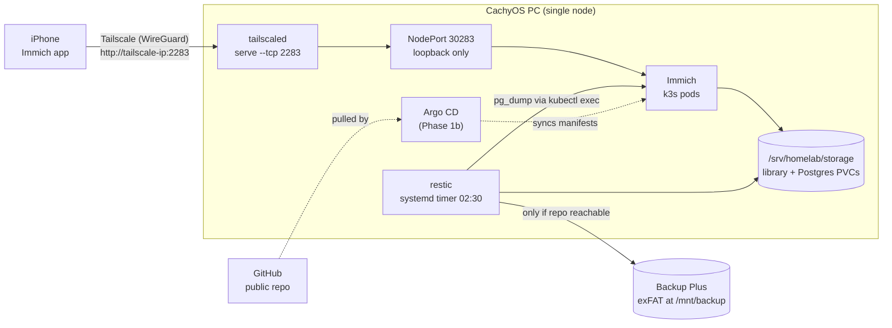

# Architecture

> [!NOTE]
> Status: Phase 0 is **applied**. Phase 1a (Immich, tailnet access, nightly backup) is **Built**; restore with real photos, the iPhone upload and a reboot test are still **unverified**. Argo CD and monitoring are **Planned** (Phase 1b). See [roadmap.md](roadmap.md).

## The picture



| Solid line | Data moves |
|---|---|
| Dotted line | Configuration moves (no photos, no secrets in plain text) |

## Components

| Component | Role | Status |
|-----------|------|--------|
| **k3s** | Single-node Kubernetes (v1.36.5). Traefik and servicelb disabled to save RAM; NodePorts bound to loopback. | Built and running (`05-k3s.sh`) |
| **Immich** | Photo and video library, iPhone auto-upload, face search. Official chart `0.13.4`, Immich `v3.2.0`, with valkey and a separate Postgres StatefulSet. | Built, pods Running; iPhone upload not yet verified |
| **Tailscale** | Private network between PC, iPhone, laptop. No router ports opened. `tailscale serve --tcp` publishes Immich on the tailnet. | PC logged in; iPhone not yet seen |
| **restic** | Encrypted, deduplicated nightly backup to the external drive, run by a host systemd timer. | Built; manual run and mechanical restore drill passed |
| **Argo CD** | Keeps the cluster equal to the Git repo. | Planned (Phase 1b) |
| **SOPS + age** | Encrypts secrets so they can live in a public repo. | Key generated (`04-secrets.sh`); first secrets in use (`immich-db`, `restic`); see [secrets.md](secrets.md) |
| **Prometheus + Grafana** | Metrics and alerts (backup age, drive, disk, swap). | Planned (Phase 1b) |

## Data flow

| Flow | Path | Protocol | Notes |
|------|------|----------|-------|
| Photo upload | iPhone -> `tailscaled` -> loopback NodePort 30283 -> Immich | Plain HTTP inside the WireGuard tunnel (no HTTPS certificate) | PC must be on and awake. iOS app behaviour with `http://` not yet verified |
| Live data | Immich -> `/srv/homelab/storage` | local-path PVC | Copy 1 of your photos |
| Backup | `backup.sh` (systemd timer) -> restic -> `/mnt/backup/homelab-restic` | restic repo (files) | Copy 2, same room. DB dumped with `pg_dump` through `kubectl exec` |
| Config | GitHub -> Argo CD -> cluster | Git over HTTPS | Public repo, secrets SOPS-encrypted |

> [!WARNING]
> Live data and the backup are two copies in **one place**. Fire, theft or a power surge can take both. An offsite copy is deferred to Phase 2. See [backup-restore.md](backup-restore.md).

## Storage layout

```text
/srv                       btrfs subvolume @srv (own subvolume, NOT covered by snapper)
└── homelab/
    ├── k3s/               k3s data-dir (containerd images, etcd/sqlite state)
    └── storage/           local-path PVCs: Immich library, Postgres   (chattr +C)
/mnt/backup                mountpoint for the exFAT drive              (chattr +i while empty)
```

- **`/srv` is its own subvolume.** Snapper here only has a `root` config on `/`, so photos under `/srv` never inflate snapshots. No extra subvolume is needed.
- **`chattr +C` on `storage/`** turns off copy-on-write for new files. This avoids heavy fragmentation for Postgres and large uploads. Side effect: no btrfs checksums or compression for those files, which is fine for JPEG/HEIC and acceptable because restic is the integrity layer. The flag must be set while the directory is empty; new files inherit it.
- **`chattr +i` on the empty mountpoint** makes the bare directory immutable. If the drive is missing, a backup job cannot write into `/mnt/backup` on the SSD and fill it. Mounting over the directory still works.

## Why each choice

| Choice | Reason | Details |
|--------|--------|---------|
| k3s | Smallest real Kubernetes; Argo CD needs a cluster | [decisions.md](decisions.md) |
| Tailscale | Private by default, no VPS, free | [decisions.md](decisions.md) |
| restic on a systemd timer | One static tool, encrypted, dedup, works on exFAT as plain files. A host timer avoids hostPath problems with the autofs drive | [decisions.md](decisions.md#10-backup-runner-systemd-timer-not-a-cronjob) |
| Loopback NodePort + `tailscale serve` | The LAN cannot reach the app; only the tailnet can | [decisions.md](decisions.md#12-loopback-nodeport-and-tailscale-serve) |
| Postgres StatefulSet | One pod, no operator, Immich's own tested image | [decisions.md](decisions.md#11-postgres-as-a-plain-statefulset) |
| exFAT folder | Keeps the existing 605 GB untouched; restic repo is portable to any OS | [decisions.md](decisions.md) |
| Public repo + SOPS | Portfolio-friendly; secrets safe if the age key stays private | [secrets.md](secrets.md) |

## Resource budget (15 GB RAM, about 5 GB free)

Stop the kind clusters and Jenkins before k3s runs (`02-free-ram.sh`). Immich server and machine-learning pods are limited to 2 Gi each, Postgres to 1 Gi. During setup about 5 GB of swap was in use, so watch it: if swap stays above 4 GB for a week, fall back to Docker Compose for Phase 1 apps ([decisions.md](decisions.md)).
