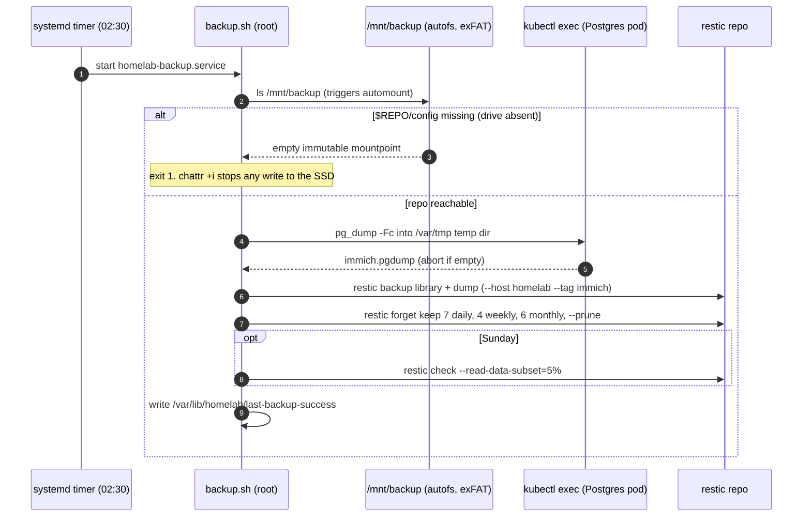

# Backup and restore

> [!NOTE]
> **Built and partly verified.** The backup job exists and has run once by hand. A mechanical restore drill passed. Still open: a restore with real photos, the timer's first scheduled run, the unplugged-drive test and a reboot test. See [what is verified](#what-is-verified).

## What is protected

| Data | How it is captured | Notes |
|------|--------------------|-------|
| Immich library (photos, videos) | restic reads `/srv/homelab/storage/*_immich_immich-library` (the library PVC directory) | Files, copied as-is while Immich is running |
| Immich database (albums, faces, metadata) | `pg_dump -Fc` run through `kubectl exec immich-postgres-0`, written to a temp dir, then added to the same snapshot | Avoids copying live Postgres files. Does not depend on Immich's own dump schedule |
| Later (Phase 2) | Vaultwarden, Nextcloud data | Added to the same job |

Not backed up: container images, k3s state (rebuilt from Git), the existing 605 GB on the drive.

## Where it goes

`/mnt/backup/homelab-restic/` on the exFAT drive "Backup Plus". A restic repository is just files, so it opens on any OS with restic installed, which makes moving to a new PC simple. restic init, backup and check were tested on this exFAT drive and work.

## How it runs

A **host systemd timer**, not a Kubernetes CronJob. The job needs the automounted drive, the host's `restic` and `kubectl`, and the k3s kubeconfig; running it in a pod would add hostPath and mount-propagation problems with an autofs mount. See [decisions.md](decisions.md#10-backup-runner-systemd-timer-not-a-cronjob).

| Piece | Where | Role |
|-------|-------|------|
| `platform/backup/backup.sh` | installed to `/usr/local/lib/homelab/backup.sh` | The backup logic |
| `homelab-backup.service` | `/etc/systemd/system/` | One-shot run as root; `CacheDirectory=restic`, `Nice=10`, idle IO priority |
| `homelab-backup.timer` | `/etc/systemd/system/` | 02:30 daily, `Persistent=true` (runs at next boot if the PC was off), up to 10 minutes random delay |
| `/etc/homelab/backup.env` | root-readable | Repo path, password file, kubeconfig, library glob |
| `/etc/homelab/restic-password` | root-only (mode 600) | Repository password, written by `install.sh` from `secrets/restic.enc.yaml` |
| `/var/lib/homelab/last-backup-success` | state dir | Unix timestamp of the last good run (Phase 1b alerts on its age) |

`platform/backup/install.sh` sets all of this up; see [getting-started.md](getting-started.md#step-9-nightly-backup-phase-1a).



### The guard

```bash
ls "$MOUNT" >/dev/null 2>&1 || true
[[ -f $REPO/config ]] || { echo "backup repo not reachable at $REPO (drive unplugged?)" >&2; exit 1; }
```

Listing the path triggers the automount. The repository `config` file exists only on the real drive. If the drive is absent, the bare mountpoint on the SSD has no such file and the job exits non-zero. As a second layer, `03-storage.sh` sets `chattr +i` on the empty `/mnt/backup`, so even a buggy job cannot write there while the drive is absent. (`mountpoint -q` is not used because an idle autofs trigger already counts as a mountpoint.)

### Retention and checks

```bash
restic forget --host homelab --tag immich --keep-daily 7 --keep-weekly 4 --keep-monthly 6 --prune
restic check --read-data-subset=5%     # Sundays only
```

Keeps a week of dailies, a month of weeklies and half a year of monthlies, deleting the rest. The fixed `--host homelab` keeps retention grouping stable. The Sunday check verifies repository structure and reads a 5% sample of data blocks, so corruption is found early without reading the whole repository weekly.

### Alerts (Planned, Phase 1b)

Backup last success older than 26 hours (from `last-backup-success`). Drive not mounted. SSD above 80% full.

## What is verified

| Check | Result |
|-------|--------|
| restic `init`, `backup`, `check` on the exFAT drive | Passed (test repo, then removed) |
| First manual run of `homelab-backup.service` | Passed: snapshot `38d67282`, 17.6 MiB (library still empty plus an 18 MB DB dump). The first attempt failed on restic's cache dir (`$HOME` undefined under systemd); fixed with `CacheDirectory=restic` and `RESTIC_CACHE_DIR` |
| Mechanical restore drill | Passed: see below |
| Timer's first scheduled run | **Not yet verified** |
| Restore drill with real photos | Verified 2026-10-22: 8 photos, restored files identical by sha256, DB dump restored into a scratch database (8 assets) |
| Unplugged-drive test (job fails, SSD usage unchanged) | Verified 2026-10-22: drive unmounted, job exits 1, SSD usage delta 0, mountpoint rejects writes |
| Reboot test (k3s, automount, tailscaled return on their own) | Verified 2026-10-22: all 9 post-reboot checks passed |

## Known weaknesses

| Risk | Why | Mitigation |
|------|-----|------------|
| **Two copies, one place** | Live data and the drive sit in the same room | Offsite copy (B2/S3) planned for Phase 2. Keep photos on the iPhone and in iCloud until then. |
| **exFAT has no journal** | Unplugging during a write can corrupt the repo | Eject properly (`sudo umount /mnt/backup`), weekly `restic check`. Reformat to ext4 later. |
| **Age key copy is on the same drive, unencrypted** | `/mnt/backup/homelab-keys/age-keys.txt` is readable by anyone holding the drive, and is lost with it | Add a copy in a cloud password manager; the age key opens `secrets/restic.enc.yaml`, so it also protects the restic password |
| **Lost restic password** | Backup is unreadable forever | Recoverable with `sops -d secrets/restic.enc.yaml` and the age key, so protect the age key. See [secrets.md](secrets.md) |
| **Library copied while Immich runs** | The files and the DB dump are taken seconds apart; a photo uploaded in between can be in one and not the other | Small window at 02:30. Immich can rescan the library after a restore; stop Immich first for a strictly consistent backup |
| **Postgres version drift** | A restore needs the same Postgres and vector-extension version | Postgres image is pinned by digest in `apps/immich/postgres.yaml` |
| **PC off or asleep** | No uploads, no nightly job (`Persistent=true` catches up at next boot) | Disable suspend; alert on backup age |

## Restore drill

Do this before trusting the backup and again after major upgrades. These are the commands that were run for the mechanical drill. `r` is a shell function; in fish use `function r; sudo restic -r /mnt/backup/homelab-restic --password-file /etc/homelab/restic-password $argv; end`.

```bash
export KUBECONFIG=$HOME/.kube/homelab
r() { sudo restic -r /mnt/backup/homelab-restic --password-file /etc/homelab/restic-password "$@"; }
d=/var/tmp/restore-drill

sudo rm -rf "$d"
r snapshots                          # list snapshots
r restore latest --target "$d"       # restore the newest one to a scratch dir
```

Restores the library directory and the DB dump under `$d`, keeping their original paths. Observed: `Restored 20 files/dirs (17.623 MiB)`.

```bash
f=$(sudo find "$d" -name immich.pgdump)
sudo cat "$f" | kubectl -n immich exec -i immich-postgres-0 -- pg_restore --list | grep -c ' TABLE '
r check
sudo rm -rf "$d"
```

`pg_restore --list` reads the dump through the Postgres pod's own `pg_restore` (same version as the server) without loading it into the live database. Observed: **142 tables**, the `cube` and `earthdistance` extensions listed, and `restic check` reported `no errors were found`.

**Still to do (full drill):** upload a few photos including a video, run `sudo systemctl start homelab-backup.service`, then restore into a scratch namespace:

1. Restore the library to a scratch directory as above and compare a sample against the live library: `diff -rq "$d/<library path>" "/srv/homelab/storage/<library path>" | head`.
2. Start a scratch Immich in a separate namespace, pointing at the restored library, and load the dump into a scratch Postgres with `pg_restore`.
3. Log in and open several photos, including old ones and a video.
4. Delete the scratch namespace and the scratch directory.

You pass when the photos open and counts match. If any step fails, fix it before moving on to Phase 1b.

## Restore on a new PC

Same procedure, different machine. See [migrate-to-new-pc.md](migrate-to-new-pc.md).

You need in hand: the drive, the age key (it opens the restic password in `secrets/restic.enc.yaml`) and this repository.
