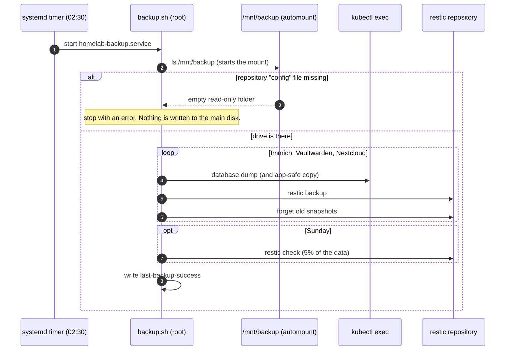

# Backup and restore

Every night the server copies its important data to the external drive. This page explains what is saved, how it runs, and how to restore it.

## What is saved

| Data | How | Notes |
|---|---|---|
| Immich photos and videos | restic copies the library folder in `/srv/homelab/storage` | Files are copied as they are, while Immich runs |
| Immich database (albums, faces) | `pg_dump` through `kubectl exec`, saved in the same snapshot | A dump is safe while the database runs. Copying live database files is not. |
| Vaultwarden (passwords) | `vaultwarden backup` makes a safe copy of the SQLite file, then restic saves the `/data` folder | |
| Nextcloud files and database | Maintenance mode on, `pg_dump`, restic saves app volume, `/srv/homelab/files` and the dump, maintenance mode off | Users cannot write while the backup runs |

**Not saved:** container images and the k3s state (both are rebuilt from git), Jellyfin settings (use Jellyfin's own backup page in its dashboard), qBittorrent settings and downloads.

## Where it goes

`/mnt/backup/homelab-restic/` on the external drive. A restic repository is just a folder of files. It opens on any system that has restic.

## How it runs

A **systemd timer** on the host starts it. It is not a Kubernetes CronJob. The reason is in [decisions.md](decisions.md#10-backup-runs-from-a-systemd-timer-not-a-cronjob).

| Piece | Where | Job |
|---|---|---|
| `platform/backup/backup.sh` | installed to `/usr/local/lib/homelab/backup.sh` | The backup steps |
| `homelab-backup.service` | `/etc/systemd/system/` | Runs the script once, as root, at low priority |
| `homelab-backup.timer` | `/etc/systemd/system/` | Starts the service at 02:30 every night. If the computer was off, it runs at the next start. |
| `/etc/homelab/backup.env` | root only | Paths and settings that `backup.sh` reads |
| `/etc/homelab/restic-password` | root only (mode 600) | The restic password, written by `install.sh` from `secrets/restic.enc.yaml` |
| `/var/lib/homelab/last-backup-success` | state folder | The time of the last good backup |

Set it all up with `platform/backup/install.sh` (see [getting-started.md](getting-started.md#step-11-turn-on-the-nightly-backup)).

> [!NOTE]
> After you change `backup.sh` in the repo, run `APPLY=1 ./platform/backup/install.sh` again. systemd runs the **installed copy**, not the one in the repo.



### The drive guard

```bash
ls "$MOUNT" >/dev/null 2>&1 || true
[[ -f $REPO/config ]] || fail "backup repository not found at $REPO (is the drive plugged in?)"
```

Opening the folder starts the automount. A real restic repository contains a file named `config`. If the drive is missing, the empty folder on the main disk has no such file, and the script stops. As a second layer, `03-storage.sh` made the empty folder read-only (`chattr +i`).

### Keeping old snapshots

```bash
restic forget --host homelab --tag immich --keep-daily 7 --keep-weekly 4 --keep-monthly 6 --prune
```

This keeps the last 7 daily snapshots, 4 weekly and 6 monthly (12 monthly for Vaultwarden and Nextcloud). It deletes the rest. The fixed name `homelab` keeps this rule stable, even if you rename the computer.

On Sundays the script also runs `restic check --read-data-subset=5%`. It checks the repository structure and reads a random 5% of the data. Damage shows up early, without reading everything each week.

### Alert

The alert `BackupStale` fires when the last good backup is older than 26 hours. See [architecture.md](architecture.md#alerts).

## Known weaknesses

| Risk | Why | What helps |
|---|---|---|
| **Two copies, one place** | The live data and the drive are in the same room | Add an offsite copy (on the [roadmap](roadmap.md)). Until then, keep irreplaceable files somewhere else too. |
| **exFAT has no journal** | Unplugging during a write can damage the repository | Eject with `sudo umount /mnt/backup`. The weekly `restic check` finds damage. Use ext4 if you can. |
| **A copy of the age key on the same drive** | Anyone who holds the drive can read it, and you lose it with the drive | Also keep a copy in a password manager |
| **restic password lost** | The backups cannot be opened | Get it back with `sops -d secrets/restic.enc.yaml` and the age key. See [secrets.md](secrets.md). |
| **Photos change during the backup** | Files and the database dump are saved a few seconds apart | The window is small at 02:30. Immich can rescan after a restore. For a strict copy, stop Immich first. |
| **Postgres version differs on restore** | A restore needs the same Postgres and vector extension | The Postgres image is pinned by digest in `apps/immich/postgres.yaml` |
| **Server off or asleep** | No uploads and no backup | Turn off sleep. `Persistent=true` catches up at the next start. The `BackupStale` alert tells you. |

## Restore drill

Do this before you trust the backup, and again after big upgrades. It restores into a scratch folder, so the live data is never touched.

```bash
export KUBECONFIG=$HOME/.kube/homelab
r() { sudo restic -r /mnt/backup/homelab-restic --password-file /etc/homelab/restic-password "$@"; }
d=/var/tmp/restore-drill

sudo rm -rf "$d"
r snapshots                          # list the snapshots
r restore latest --target "$d"       # restore the newest snapshot into the scratch folder
```

`r` is a small shell function that saves typing. The restore keeps the original folder names under `$d`.

Check that the database dump can be read:

```bash
dump=$(sudo find "$d" -name immich.pgdump)
sudo cat "$dump" | kubectl -n immich exec -i immich-postgres-0 -- pg_restore --list | grep -c ' TABLE '
r check
sudo rm -rf "$d"
```

`pg_restore --list` reads the dump with the Postgres pod's own `pg_restore` (the same version as the server). It does not load anything into the live database. You should see a list of tables, and `restic check` should say `no errors were found`.

### Full drill

1. Compare the restored library with the live one: `diff -rq "$d/<library path>" "/srv/homelab/storage/<library path>" | head`. Photos added after the snapshot will show up. Nothing else should.
2. Start a scratch Immich in another namespace. Point it at the restored library. Load the dump into a scratch Postgres with `pg_restore`.
3. Log in and open some photos, including old ones and a video.
4. Delete the scratch namespace and the scratch folder.

You pass when the photos open and the counts match. If a step fails, fix it before you rely on the backup.

## Restore on a new computer

The steps are the same on another machine. See [migrate-to-new-pc.md](migrate-to-new-pc.md). You need: the drive, the age key and this repo.
