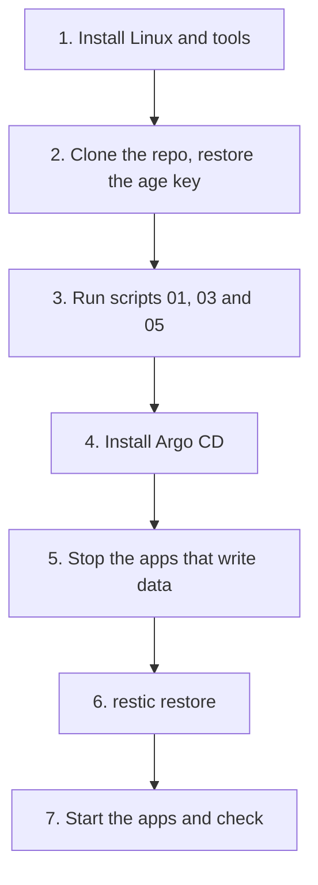

# Move to another computer

Use this page to rebuild HomeLab on a new computer.

> [!WARNING]
> Practise this once before you need it. The [restore drill](backup-restore.md#restore-drill) is a good dry run.

## What you need first

| Item | Where it should be | If you do not have it |
|---|---|---|
| The backup drive | At hand | There is nothing to restore from |
| The restic password | Password manager, and a copy on the drive | The backups cannot be opened |
| The age private key | Password manager, and a copy on the drive | You must create new secrets ([secrets.md](secrets.md)) |
| The repo URL | GitHub | `git clone` fails |
| Your Tailscale login | Your account | Join the devices again by hand |

## The steps



### 1. Prepare the computer

Install Linux. Then install the tools: `git`, `age`, `sops`, `restic`, `tailscale`, `helm`, `kubectl`. Install Docker only if you use `02-free-ram.sh`.

```bash
sudo systemctl enable --now tailscaled
sudo tailscale up
```

### 2. Clone the repo and restore the age key

```bash
git clone <your repo url> ~/HomeLab && cd ~/HomeLab
mkdir -p ~/.config/sops/age
install -m 600 /path/to/keys.txt ~/.config/sops/age/keys.txt    # the key from your password manager or the drive
```

The repo has every manifest. The key is the only thing it does not have.

> [!WARNING]
> Do **not** run `04-secrets.sh` with `APPLY=1`. It would make a new key, and your old secrets could no longer be opened.

### 3. Storage and k3s

Plug in the drive. Then run the scripts from [getting-started.md](getting-started.md): `01-preflight.sh`, `03-storage.sh` and `05-k3s.sh`. Skip `04-secrets.sh`. Skip `02-free-ram.sh` unless you need it.

If you have a separate big drive for media and files, mount it at `/srv/homelab/media` and `/srv/homelab/files` (in `/etc/fstab`) before you start the apps. No manifest changes are needed.

### 4. Argo CD and the apps

```bash
APPLY=1 ./argocd/install.sh
```

Then run the `install.sh` of each app that has one (Immich, Vaultwarden, Nextcloud, Homepage). The encrypted secret files are already in the repo, so the scripts decrypt them with your age key and apply them. Argo CD then creates all the apps, with empty data.

### 5. Pause Argo CD and stop the apps

Argo CD would start the apps again while you restore. Pause it first, then stop the apps. The databases (StatefulSets) keep running, because you need them for the restore.

```bash
kubectl -n argocd scale statefulset argocd-application-controller --replicas=0
kubectl -n immich scale deploy --all --replicas=0
kubectl -n vaultwarden scale deploy --all --replicas=0
kubectl -n nextcloud scale deploy --all --replicas=0
```

### 6. Restore the data

First restore everything into a scratch folder. This never touches live data.

```bash
export RESTIC_REPOSITORY=/mnt/backup/homelab-restic
sudo -E restic snapshots
sudo -E restic restore latest --target /var/tmp/restore    # asks for the restic password
```

The new cluster named its volume folders itself, so the names differ from the old server. Look at them and copy each restored folder into the matching new one:

```bash
ls /srv/homelab/storage          # new folders, e.g. pvc-<id>_immich_immich-library
find /var/tmp/restore/srv/homelab/storage -maxdepth 1    # restored folders
sudo rsync -a /var/tmp/restore/srv/homelab/storage/<old immich-library folder>/ /srv/homelab/storage/<new immich-library folder>/
```

Do the same for the Vaultwarden data folder and the Nextcloud app folder (`..._nextcloud_nextcloud-html`). Nextcloud user files go to `/srv/homelab/files`:

```bash
sudo rsync -a /var/tmp/restore/srv/homelab/files/ /srv/homelab/files/
```

Then load each database dump into its running Postgres pod:

```bash
dump=$(sudo find /var/tmp/restore -name immich.pgdump)
sudo cat "$dump" | kubectl -n immich exec -i immich-postgres-0 -- \
  sh -c 'pg_restore -U "$POSTGRES_USER" -d "$POSTGRES_DB" --clean --if-exists'
```

Repeat with `nextcloud.pgdump` and `nextcloud-postgres-0` in the `nextcloud` namespace. Finally delete the scratch folder: `sudo rm -rf /var/tmp/restore`.

### 7. Start the apps and check

Start Argo CD again. It brings every app back to its normal state.

```bash
kubectl -n argocd scale statefulset argocd-application-controller --replicas=1
```

Then check:

- [ ] Immich opens on the tailnet
- [ ] Old photos and videos open. The photo count matches the old server.
- [ ] Albums and face groups are there (the database restored)
- [ ] The phone app uploads a new photo to the new address
- [ ] Nextcloud and Vaultwarden open, and your data is there
- [ ] The nightly backup runs once on the new computer (`APPLY=1 ./platform/backup/install.sh`, then `sudo systemctl start homelab-backup.service`)

Keep the old computer and its data until every box is ticked.
