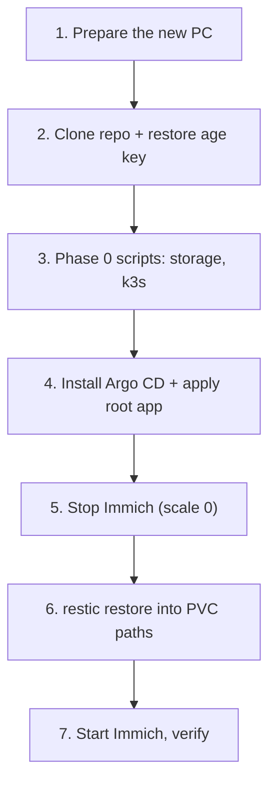

# Migrate to a new PC

> [!WARNING]
> **Planned, untested.** Written before the stack exists. Rehearse it once (use the [restore drill](backup-restore.md#restore-drill) as the dry run) before you depend on it.

## Have these in hand first

| Item | Where it is | If missing |
|------|-------------|------------|
| Backup drive "Backup Plus" | Your desk | Nothing to restore from |
| restic password | Cloud password manager (and a copy on the drive) | Backup is unreadable |
| age private key | Cloud password manager (and a copy on the drive) | Secrets must be recreated ([secrets.md](secrets.md)) |
| This repo's URL | GitHub (public) | `git clone` fails |
| Tailscale account | Your login | Re-join devices manually |

## Steps



### 1. Prepare the new PC

Install Linux, then the tools:

```bash
sudo pacman -S git age sops restic tailscale docker helm kubectl   # Arch-family; adjust per distro
sudo systemctl enable --now tailscaled && sudo tailscale up
```

Docker is only needed if you want your kind clusters; k3s does not require it. Join the PC to your tailnet.

### 2. Clone the repo and restore the age key

```bash
git clone <your repo url> ~/Projects/HomeLab && cd ~/Projects/HomeLab
mkdir -p ~/.config/sops/age
# paste or copy the key from your password manager / the drive:
install -m 600 /path/to/keys.txt ~/.config/sops/age/keys.txt
```

The repo gives you all manifests. The key is the only thing not in it. Do not run `04-secrets.sh` with `APPLY=1`: it would create a *new* key.

### 3. Storage and k3s

Plug in the drive, then run Phase 0 steps 1, 3 and 5 from [getting-started.md](getting-started.md) (`01-preflight`, `03-storage`, `05-k3s`). Skip `04-secrets` and `02-free-ram` unless needed.

### 4. Argo CD and the root app (Planned, Phase 1b)

Install Argo CD with the KSOPS plugin, create the age key as a Kubernetes Secret for it, then apply the root app-of-apps from `argocd/`. Argo creates every app, empty. Exact commands will be written into `bootstrap/` when Phase 1b is built.

### 5. Scale Immich to zero

```bash
kubectl -n immich scale deploy --all --replicas=0
```

Stops the app so nothing writes while you restore.

### 6. Restore data

```bash
export RESTIC_REPOSITORY=/mnt/backup/homelab-restic
restic snapshots
restic restore latest --target /
```

Opens the repository (asks for the restic password) and writes the files back to their original paths under `/srv/homelab/storage`. Check the target paths with `--dry-run` first. Then load the Immich DB dump as described in the Immich documentation for the pinned version.

### 7. Start and verify

```bash
kubectl -n immich scale deploy --all --replicas=1
```

- [ ] Immich UI loads over the tailnet
- [ ] Old photos and videos open; photo count matches the old server
- [ ] Face groups and albums are present (DB restored)
- [ ] iPhone app points at the new tailnet address and uploads a new photo
- [ ] Nightly restic job runs once successfully on the new PC

Keep the old PC and its data until every box is ticked.
