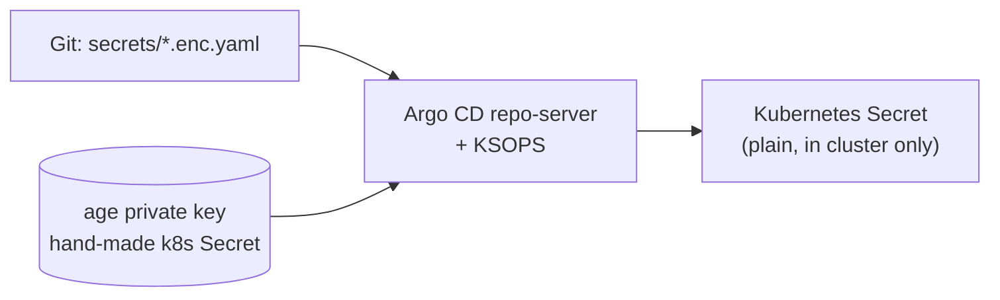

# Secrets: SOPS + age in a public repo

> [!WARNING]
> This repo is **public**. A plain-text secret committed even once stays in Git history forever. Everything below exists to make that mistake hard.

## The idea

Think of the age key as a house key and SOPS as a locksmith who locks only the *values* in a file. Names and structure stay readable, so diffs still make sense.

| Piece | What it is | Where it lives |
|-------|------------|----------------|
| age **public** key (`age1...`) | Locks | In the repo, inside `.sops.yaml` |
| age **private** key (`AGE-SECRET-KEY-...`) | Unlocks | `~/.config/sops/age/keys.txt`, **never in Git** |
| `secrets/*.enc.yaml` | Locked files | In the repo |

## Setup

`bootstrap/scripts/04-secrets.sh` does this for you (see [getting-started.md](getting-started.md)). By hand:

```bash
mkdir -p ~/.config/sops/age
age-keygen -o ~/.config/sops/age/keys.txt     # prints the public key
```

Creates the key pair. The public key goes into `.sops.yaml`.

### `.sops.yaml` explained

```yaml
creation_rules:
  - path_regex: secrets/.*\.enc\.ya?ml$
    encrypted_regex: ^(data|stringData)$
    age: age1REPLACE_ME
```

| Field | Meaning |
|-------|---------|
| `path_regex` | Only files named `secrets/<anything>.enc.yaml` or `.enc.yml` get these rules |
| `encrypted_regex` | Only the `data` and `stringData` blocks of a Kubernetes Secret are scrambled; `metadata`, names and labels stay readable |
| `age` | Public key(s) the file is locked for. Add a second key here for a spare recipient |

## Daily use

Create a new secret (the file name must match `path_regex`):

```bash
cat > secrets/immich-db.enc.yaml <<'EOF'
apiVersion: v1
kind: Secret
metadata:
  name: immich-db
  namespace: immich
stringData:
  password: change-me
EOF
sops --encrypt --in-place secrets/immich-db.enc.yaml
```

Writes the file, then replaces the values with `ENC[AES256_GCM,...]` and adds a `sops:` block. Do not `git add` the file before the encrypt step.

```bash
sops secrets/immich-db.enc.yaml          # opens decrypted in $EDITOR, re-locks on save
sops --decrypt secrets/immich-db.enc.yaml  # print plain text to the terminal (do not redirect into the repo)
```

Edit in place or read once. Never save decrypted output as a tracked file; `*.dec.yaml` is git-ignored as a safety net.

## How the cluster reads them (Planned, Phase 1b)

Argo CD cannot read SOPS files on its own. The plan is the **KSOPS** plugin in Argo's repo-server:



The private key is created once by hand as a Kubernetes Secret. It is not in Git. Until Phase 1b, Phase 1a secrets are created by hand with `kubectl create secret` and are not committed.

## Backing up the keys

Two secrets must survive the loss of this PC and the cluster:

| Secret | Why it is critical | Store in |
|--------|--------------------|----------|
| age private key | Without it, every `*.enc.yaml` is unreadable | Cloud password manager **and** a copy on the backup drive |
| restic password | Without it, the photo backup cannot be opened, ever | Cloud password manager **and** a copy on the backup drive |

> [!WARNING]
> Do **not** keep these only in a self-hosted Vaultwarden. It runs inside this cluster, so it disappears together with the cluster you are trying to recover.

The restic password is also the one secret that must not live only in an encrypted Git file: if you lose the age key, you would lose the password that opens your photo backup.

## When things go wrong

| Situation | Impact | What to do |
|-----------|--------|------------|
| **Private key lost** | Encrypted files unreadable. Photos are safe (restic has its own password). | Generate a new key, invent new passwords, re-encrypt, push. Postgres remembers its old password inside its data: reset it with `ALTER USER`. |
| **Private key leaked** | Anyone can read every secret, including old versions in Git history. | Rotate every password, generate a new key, re-encrypt, replace the key in the cluster. Rewriting history is not enough. |
| **Plain secret committed** | Already public if pushed. | Treat as leaked: rotate that password at once. Then remove it from history. |
| **restic password lost** | Backup unreadable. | No recovery. Prevent with the two copies above. |

## Guard rails: the pre-commit hook

`.githooks/pre-commit` runs on every commit (enabled with `git config core.hooksPath .githooks`):

| Check | Blocks the commit when |
|-------|------------------------|
| SOPS metadata | a staged `secrets/*.yaml` or `.yml` has no top-level `sops:` key |
| gitleaks | gitleaks finds a likely secret in staged changes (commit fails if gitleaks is not installed) |
| Shell syntax | `bash -n` fails on a staged `*.sh` file |

Also enable GitHub secret scanning and push protection on the repository (Settings, Code security).

> [!NOTE]
> Hooks are local and can be skipped with `--no-verify`. They stop accidents, not intent. Push protection on GitHub is the second layer.

## Why not Vault or Sealed Secrets?

Short version, details in [decisions.md](decisions.md):

- **Vault** adds a service to run, back up and unseal. Its unseal keys are the same kind of key problem as the age key, for about five secrets.
- **Sealed Secrets** needs no Argo plugin, but the files only open with the cluster's own key, which complicates moving to a new PC.
