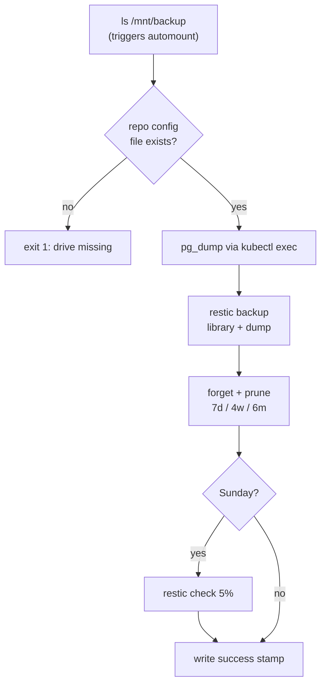

# platform/backup

Nightly encrypted backup of Immich to the external drive with restic. **Built; first run and mechanical restore drill passed.**

> [!NOTE]
> This is a host **systemd timer**, not a Kubernetes CronJob. restic and `kubectl` run on the host, which avoids mount-propagation problems with the autofs-mounted drive.

## Files

| File | What it does |
|---|---|
| `backup.sh` | The job. Installed to `/usr/local/lib/homelab/` and run as root. |
| `homelab-backup.service` | One-shot unit that runs `backup.sh` with low CPU/IO priority. |
| `homelab-backup.timer` | Fires daily at 02:30 (+ up to 10 min random). `Persistent=true` catches up after downtime. |
| `install.sh` | Creates the repo password, initialises the repo, installs the config and units, enables the timer. |

## What `backup.sh` does



## Code blocks worth knowing

- **Drive guard:** the empty mountpoint on the SSD is immutable and has no restic `config` file, so a missing drive fails the job instead of filling the SSD.
- **`pg_dump` instead of copying Postgres files:** a dump is consistent while the database runs. The library files are copied live, so a photo uploaded mid-backup may be in one and not the other.
- **`--host homelab`:** keeps retention grouping stable even if the machine is renamed.
- **Success stamp** `/var/lib/homelab/last-backup-success`: Phase 1b alerts when it is older than 26 hours.

## Operate

```bash
APPLY=1 ./platform/backup/install.sh          # install / reinstall
sudo systemctl start homelab-backup.service   # run now
journalctl -u homelab-backup.service -e       # logs
systemctl list-timers homelab-backup.timer    # next run
sudo restic -r /mnt/backup/homelab-restic --password-file /etc/homelab/restic-password snapshots
```

Restore walkthrough: [../../docs/backup-restore.md](../../docs/backup-restore.md).

## Known limits

- Two copies, one location: the live library and the drive. An offsite copy is Phase 2.
- The restic password is readable by root in `/etc/homelab/restic-password` so the timer can run unattended.
