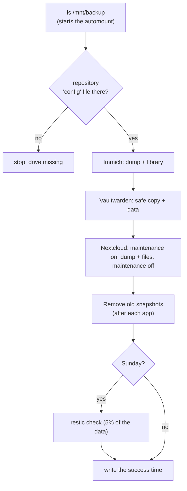

# platform/backup/

The nightly encrypted backup of Immich, Vaultwarden and Nextcloud to the external drive, using restic.

> [!NOTE]
> This is a **systemd timer** on the host, not a Kubernetes CronJob. `restic` and `kubectl` run on the host, which avoids mount problems with the automount drive. The reason is in [decisions.md](../../docs/decisions.md#10-backup-runs-from-a-systemd-timer-not-a-cronjob).

## Files

| File | What it does |
|---|---|
| `backup.sh` | The backup. `install.sh` copies it to `/usr/local/lib/homelab/`. systemd runs it as root. |
| `homelab-backup.service` | Runs `backup.sh` once, at low CPU and disk priority |
| `homelab-backup.timer` | Starts the service every night at 02:30 (plus up to 10 random minutes). `Persistent=true` runs it at the next start if the computer was off. |
| `install.sh` | Creates the backup password, creates the restic repository, installs the settings and the units, turns the timer on |

## What `backup.sh` does



Vaultwarden and Nextcloud are skipped if they are not installed.

## Ideas worth knowing

- **The drive guard.** The empty mount point on the main disk is read-only and has no restic `config` file. A missing drive stops the job instead of filling the main disk.
- **`pg_dump` instead of copying database files.** A dump is consistent while the database runs. The library files are copied live, so a photo uploaded during the backup may be in one and not in the other.
- **`--host homelab`.** A fixed name keeps the "keep the last N snapshots" rules stable, even if the computer is renamed.
- **The success time.** `/var/lib/homelab/last-backup-success` and `homelab_backup.prom`. Prometheus reads the `.prom` file, and the `BackupStale` alert fires when it is older than 26 hours.
- **A cleanup that always runs.** `backup.sh` has a `trap cleanup EXIT`. Even after an error it turns Nextcloud maintenance mode off and deletes the temporary dumps.

## Use it

```bash
APPLY=1 ./platform/backup/install.sh          # install or update
sudo systemctl start homelab-backup.service   # run a backup now
journalctl -u homelab-backup.service -e       # read the log
systemctl list-timers homelab-backup.timer    # when is the next run?
sudo restic -r /mnt/backup/homelab-restic --password-file /etc/homelab/restic-password snapshots
```

After you change `backup.sh`, run `install.sh` again. systemd runs the installed copy.

How to restore: [docs/backup-restore.md](../../docs/backup-restore.md). How to check that it works: [docs/health-check.md](../../docs/health-check.md).

## Known limits

- Two copies in one place: the live data and the drive. An offsite copy is on the [roadmap](../../docs/roadmap.md).
- The restic password is saved in `/etc/homelab/restic-password`, readable by root, so the timer can run with nobody logged in.
