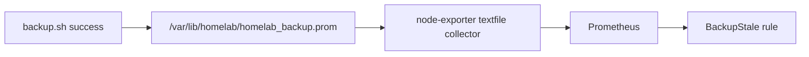

# platform/monitoring

Prometheus + Grafana via `kube-prometheus-stack`, deployed by Argo CD. **Prepared, not applied** (Phase 1b).

| File | What it does |
|---|---|
| `values.yaml` | Chart overrides: 7-day retention, small memory limits, Alertmanager off, k3s-embedded control-plane scrapes off, Grafana admin from a Secret, node-exporter reads the backup metric. |
| `rules.yaml` | Alerts: `BackupStale` (no good backup in 26 h or metric missing), `SrvDiskAlmostFull` (/srv above 80%), `HighSwapUse` (swap above 50% for 30 min, the Compose fallback trigger). |
| `grafana-nodeport.yaml` | Loopback NodePort 30300 for `tailscale serve --bg --tcp 3000 tcp://127.0.0.1:30300`. |

## How the backup alert works

`backup.sh` in the repo already writes the `.prom` file. The copy installed in `/usr/local/lib/homelab/` is still the old version: re-run `APPLY=1 ./platform/backup/install.sh` after the upload finishes.

## Limits

- node-exporter runs on the pod network (not host network) so port 9100 is not exposed to the LAN. Host NIC metrics are therefore not available.
- No Alertmanager, so alerts show in the Prometheus/Grafana UI and do not notify you. Add it with a receiver (e.g. Telegram or email) later.
- Untested: the `/srv` mountpoint label in the disk rule may differ inside node-exporter's container.
