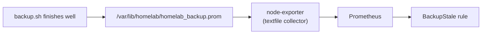

# platform/monitoring/

Prometheus (collects numbers) and Grafana (draws graphs), installed from the `kube-prometheus-stack` chart. Argo CD deploys them.

## Files

| File | What it does |
|---|---|
| `values.yaml` | Chart settings: 7-day data retention, small memory limits, Alertmanager off, the k3s control-plane scrapes off, the Grafana admin login from a secret, node-exporter reads the backup file |
| `rules.yaml` | The alerts: `BackupStale` (no good backup for 26 hours, or no data), `SrvDiskAlmostFull` (`/srv` above 80%), `HighSwapUse` (swap above 50% for 30 minutes) |
| `grafana-nodeport.yaml` | Private NodePort 30300. Publish it: `sudo tailscale serve --bg --tcp 3000 tcp://127.0.0.1:30300` |
| `prometheus-nodeport.yaml` | Private NodePort 30900. Publish it: `sudo tailscale serve --bg --tcp 9090 tcp://127.0.0.1:30900`. Prometheus has no login, so keep it on the tailnet only. |

## How the backup alert works

`backup.sh` writes the `.prom` file. If you change `backup.sh`, run `APPLY=1 ./platform/backup/install.sh` so the installed copy matches.

## Limits

- node-exporter runs on the pod network, not the host network, so port 9100 is not open to the home network. As a result, network card metrics of the host are not available.
- There is no Alertmanager. Alerts show in the Prometheus or Grafana web page, and nothing is sent to you. Add Alertmanager with a receiver (email or chat) to get messages.
- The `/srv` mount point name in the disk alert may be different inside node-exporter's container. Check that the alert gets data.
